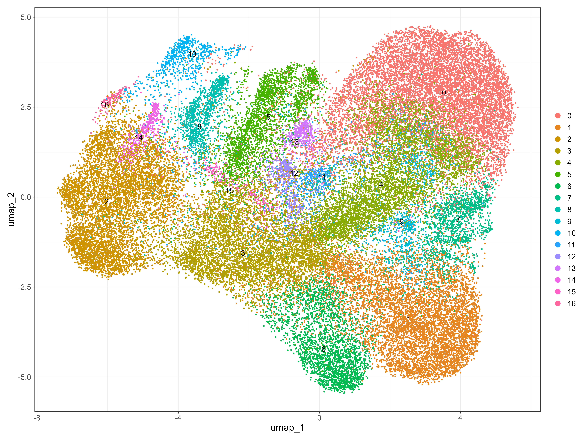
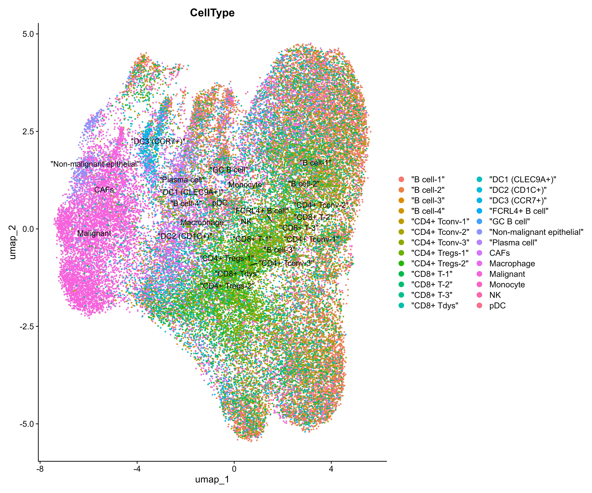
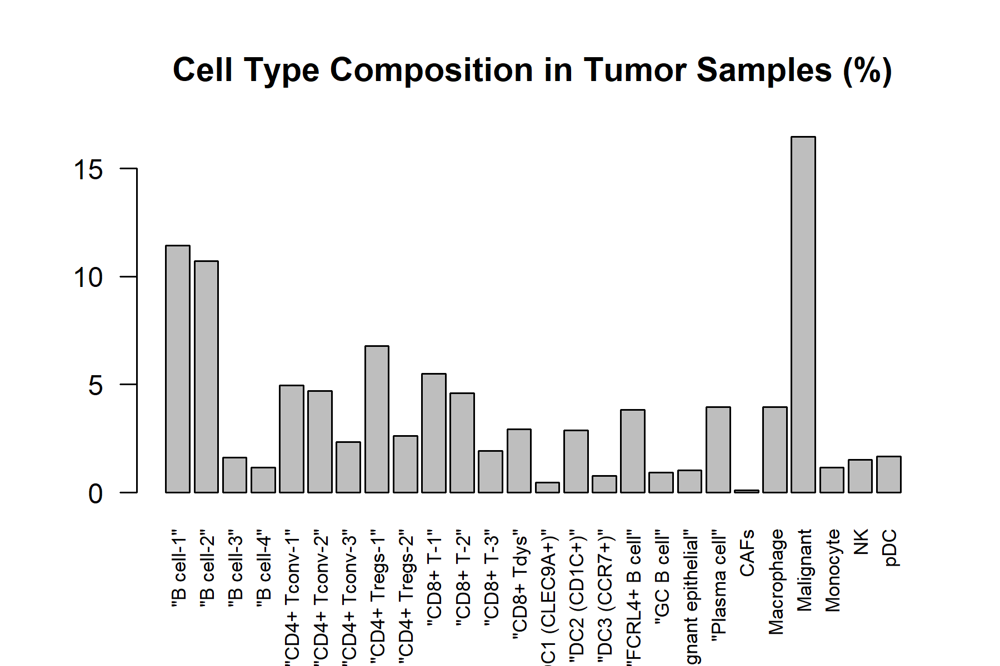
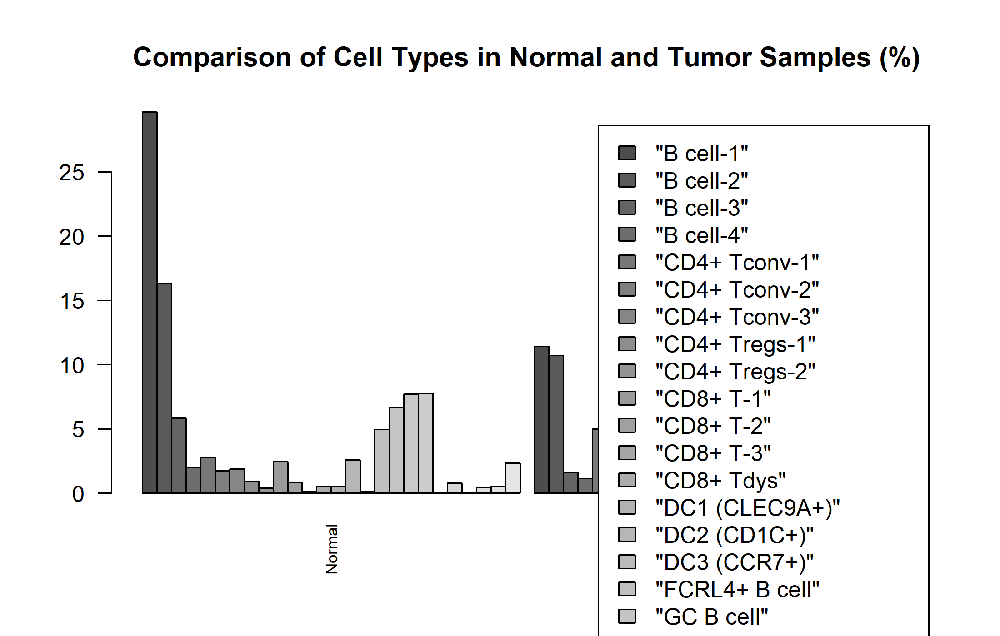

# Comparative Analysis of Immune Cell Composition Between Normal and Tumor Tissue Using scRNA-seq

**M.Sc. Biotechnology dissertation project**
**Dataset:** GSE150430 — nasopharyngeal carcinoma (NPC)
**Submitted at:** Mewar University

## Project overview

This project investigated cell populations in normal and tumor tissue in a publicly available NPC single-cell RNA-sequencing dataset. The submitted work reports cluster visualisation, cell-type annotation, marker-gene analysis, and a comparison of cellular composition between the two groups.

The methods described in the submitted presentation include data import into Seurat, quality assessment, normalization, dimensionality reduction, clustering, UMAP visualisation, cell-type annotation, marker-gene identification, and normal-versus-tumor comparison.

## Results reported in the submitted dissertation

These values reproduce the summary presented in the submitted thesis presentation; they are not presented here as an independent re-analysis.

| Metric | Value reported in submitted work |
|---|---:|
| Cells in saved Seurat object | 47,086 |
| Normal cells | 2,518 |
| Tumor cells | 44,568 |
| Features in saved Seurat object | 199 |
| Clusters | 17 |
| Annotated cell populations | 26 |

## Figures from the submitted analysis

The images below are preserved as outputs associated with the submitted work. They have not been regenerated from a complete, independently validated Seurat pipeline.

### Cluster UMAP



### Annotated cell-type UMAP



### Cell-type composition in tumor samples



### Normal-versus-tumor cell-type comparison



## Repository contents

```text
.
├── R/
│   └── audit_source_metadata.R
├── docs/
│   ├── RECOVERED_COMMAND_AUDIT.md
│   └── SUBMISSION_AND_VALIDATION_STATUS.md
├── figures/
│   └── submitted analysis figures
└── results/
    └── tables/
        ├── source_group_celltype_counts.csv
        └── source_group_celltype_percentages.csv
```

The original compressed GEO input is not committed to this repository. It is large and remains in the local project data folder.

## Run the available source-metadata audit

The script `R/audit_source_metadata.R` reads the source file's cell-barcode and cell-type metadata rows and writes aggregate counts and within-group percentages. **It does not rebuild the Seurat object, PCA, clustering, UMAP, or marker-gene results.**

In Windows RStudio, open the repository as the working directory, then set the location of the original input file and run:

```r
Sys.setenv(
  GSE150430_FILE = "C:/Users/HP/Documents/scRNAthesis/data/GSE150430_npc_scRNA_hg19_processed_data.txt.gz"
)
source("R/audit_source_metadata.R")
```

Change the path if the source file is stored elsewhere. The script writes only aggregate summary tables under `results/tables/`.

## Reproducibility note

A post-submission check found a discrepancy between the saved Seurat object and the full source-file metadata. The source metadata audit identified 48,584 cell barcodes (2,583 normal and 46,001 tumor), while the submitted object summary reports 47,086 cells (2,518 normal and 44,568 tumor). All 47,086 barcodes in the saved object were found in the source, but 1,498 source barcodes were absent from the object; the reason has not been established.

The source file contains approximately 24,720 gene rows, while the saved object contains 199 features. The 199 retained feature-value rows matched their corresponding source rows across the saved cells, but this does not validate the work as a genome-wide analysis. The saved layer named `counts` contains fractional values, and `percent.mt` was zero for every saved cell. The original Seurat construction and dimensionality-reduction commands have not been recovered from the available logs.

For these reasons, the figures and result counts above are described as **outputs from the submitted work**, not as independently reproduced final scientific results. The source metadata audit is a separate post-submission check, and the discrepancy remains unresolved. Details are recorded in [`docs/SUBMISSION_AND_VALIDATION_STATUS.md`](docs/SUBMISSION_AND_VALIDATION_STATUS.md).

## Tools and skills represented

- R and RStudio
- Seurat object inspection and single-cell RNA-seq concepts
- Cell metadata handling and Normal/Tumor grouping
- Aggregate cell-type composition summaries
- R-based figures and tables
- Source-data checks and Git/GitHub project organisation

## Data source

NCBI Gene Expression Omnibus accession [GSE150430](https://www.ncbi.nlm.nih.gov/geo/query/acc.cgi?acc=GSE150430).
